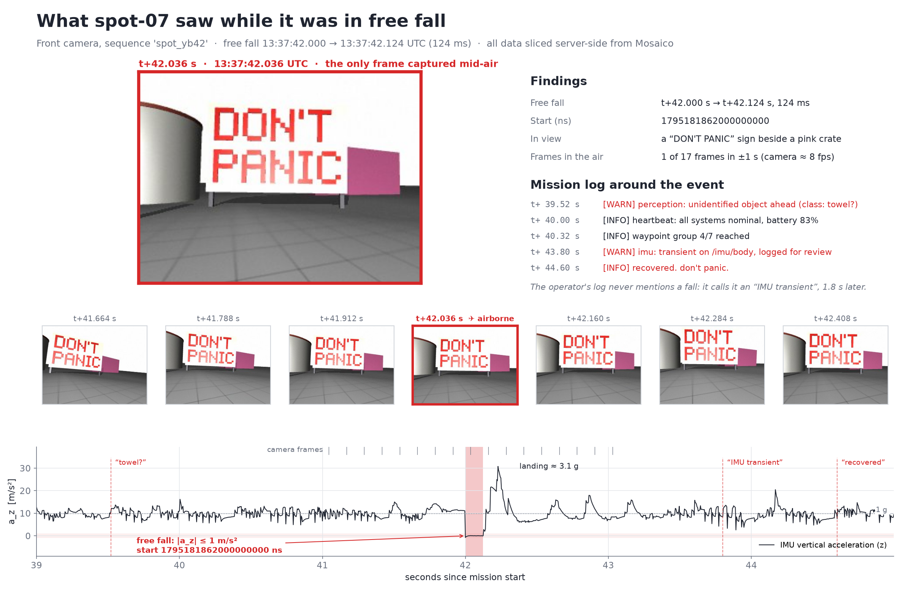
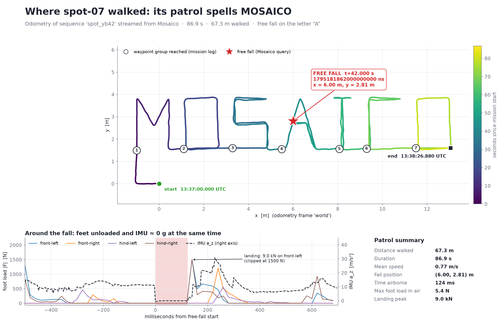

# Mission YB-42: the night spot-07 fell

My solution to the selection challenge for **Physical Education Vol. 1 · Mosaico Hack Days**
(Milan, 27–29 November 2026).

> Last night, spot-07 ran a patrol of Yard B. The night-shift operator swears nothing happened.
> **Find the moment spot-07 was in free fall, with a single Mosaico query.**

Something did happen. For 124 ms, all four of the robot's feet were off the ground and its IMU read zero g.

## Answer

| | |
|---|---|
| **Free-fall start** | **`1795181862000000000`** ns |
| UTC | `2026-11-20T13:37:42.000000000Z` |
| Mission time | t + 42.000 s |
| Window | 42.000 s → 42.124 s (124 ms) |
| Query | [`query.py`](query.py) |

```python
from mosaicolabs import MosaicoClient, IMU, QuerySequence, QueryTopic, QueryOntologyCatalog

with MosaicoClient.connect("localhost", 6726) as client:
    resp = client.query(
        QuerySequence().with_name("spot_yb42"),
        QueryTopic().with_name("/imu/body"),
        QueryOntologyCatalog(IMU.Q.acceleration.z.between([-1.0, 1.0])),
    )
    window = resp[0].topics[0].clusterize(clustering_dt_ns=100_000_000)[0]
    print(window.timerange.start)   # 1795181862000000000
```

The query is evaluated entirely by `mosaicod`. `client.query()` finds the IMU topic whose values match the
filter, and `clusterize()` asks the server *when* they match, returning the exact `[start_ns, end_ns]` window.
The same request as raw JSON (the `topic_filter_clusterize` action):

```json
{
  "locator": "spot_yb42/imu/body",
  "clustering_dt_ns": 100000000,
  "ontology": { "IMU.acceleration.z": { "$between": [-1.0, 1.0] } }
}
```

## Why this query finds free fall

An accelerometer does not measure gravity directly. It measures *specific force*: acceleration minus gravity.

- **Standing or walking**, the ground pushes back, so the vertical axis reads about **+9.8 m/s²** (1 g).
- **In free fall**, the sensor falls with the robot, so it reads about **0 m/s²**.

The filter therefore asks for samples where `acceleration.z` is within **±1 m/s² (≈ 0.1 g)** of zero, which is
"almost no vertical acceleration". `clusterize()` merges consecutive matches less than 100 ms apart into one event,
so a single sensor glitch cannot be reported as a separate fall.

## How I know it's right

**1. An independent check against the raw file.** [`03_verify_raw.py`](scripts/03_verify_raw.py) decodes
`/imu/body` directly from the MCAP, without Mosaico, and finds the same window to the nanosecond:

```
sample before : t+41.996s  az = +11.083 m/s^2
first in fall : t+42.000s  az =  -0.737 m/s^2
Mosaico start_ns 1795181862000000000 vs raw 1795181862000000000: PASS
```

**2. The answer doesn't depend on a hand-picked threshold.** Every reasonable definition of "almost zero" gives
the same start:

| \|a_z\| ≤ | windows | first start | duration | comment |
|---:|---:|---:|---:|---|
| 0.25 m/s² | 1 | 42.012 s | 112 ms | too strict: misses the first falling samples |
| 0.50 m/s² | 1 | 42.004 s | 120 ms | too strict: first sample reads −0.74 |
| **0.75 – 2.0** | **1** | **42.000 s** | **124 ms** | **stable** |
| 3.0 m/s² | 4 | 42.000 s | 136 ms | plus 3 single-sample noise spikes |
| 4.0 m/s² | 12 | 7.688 s | — | too loose: catches normal footsteps |
| 5.0 m/s² | 28 | 0.164 s | — | too loose |

**3. The right clock.** Each IMU message carries two timestamps. Mosaico indexes the **log time**
(`…862000000000`). The sensor's own header stamp for the same sample is `…861999695515`, about 0.3 ms earlier.
The answer above is the log time, which is the value Mosaico returns.

**4. Why the IMU and not the foot sensors?** The foot load cells read under 6 N during the whole window, then
**9.0 kN** on landing. But "all four feet unloaded" alone is not a fingerprint of the fall: in this recording it
also happens **30+ times during normal trotting**, in 60–180 ms flight phases. Only the IMU reading zero g
identifies true free fall.

## What the robot saw

The camera runs at about 8 fps, so it captured **exactly one frame while airborne**, at t + 42.036 s. It shows a
**"DON'T PANIC"** sign.



The mission log never mentions a fall. It calls the event an "IMU transient", logged 1.8 s afterwards:

```
t+39.52 s  [WARN] perception: unidentified object ahead (class: towel?)
t+43.80 s  [WARN] imu: transient on /imu/body, logged for review
t+44.60 s  [INFO] recovered. don't panic.
```

## Where the robot walked

The patrol traces the word **MOSAICO**: 67.3 m in 86.9 s. The free fall happened on the **"A"**, at
x = 6.00 m, y = 2.81 m.



## Easter eggs

The dataset is a *Hitchhiker's Guide to the Galaxy* tribute:

- the fall starts at exactly **42**.000 s, and the random seed is 42
- firmware `4.2.0-hhgttg`
- a **towel** is spotted just before the fall
- the robot sees **DON'T PANIC** while airborne
- the last log line: *"so long, and thanks for all the fish"*
- the mission starts at **13:37** UTC

## Reproduce

Tested on Windows 11 + WSL2 (Ubuntu 26.04). `mosaicod` runs on Linux only.

```bash
# 1. Mosaico daemon + PostgreSQL (official installer; review it first)
curl -fsSL https://get.mosaico.dev -o get-mosaico.sh
sudo sh get-mosaico.sh --dry-run
sudo sh get-mosaico.sh -y

# 2. Python environment
python3 -m venv ~/.venvs/yb42 && . ~/.venvs/yb42/bin/activate
pip install -r requirements.txt

# 3. Challenge files (from the Discord challenge) go in ./Hackathon-challenge/
#    spot_yb42.mcap, sequence_metadata.json

# 4. Run
bash   scripts/01_ingest.sh          # ingest (exact command from the brief)
python scripts/02_find_freefall.py   # the query  -> results/answer.json
python scripts/03_verify_raw.py      # raw check  -> results/threshold_sweep.csv
python scripts/04_what_it_saw.py     # camera     -> results/what_it_saw.png
python scripts/05_where_it_walked.py # trajectory -> results/where_it_walked.png
python scripts/06_form_images.py     # simple images used in the submission form
```

Every figure is built from data streamed out of Mosaico, sliced server-side by time window.

| Component | Version |
|---|---|
| `mosaicod` | `0.7.0-rc` (`c18683a6`, built 2026-10-13; image tag `latest`) |
| `mosaicolabs` SDK | 0.7.0 |
| Python | 3.14 |

## Repository layout

```
query.py                  the exact query submitted
scripts/
  01_ingest.sh            dry run + ingest
  02_find_freefall.py     the Mosaico query, writes results/answer.json
  03_verify_raw.py        independent check against the raw MCAP + threshold sweep
  04_what_it_saw.py       camera frames around the fall
  05_where_it_walked.py   trajectory, waypoints, foot loads
  06_form_images.py       simple images for the submission form
  common.py               shared Mosaico helpers and plot style
results/                  answer.json, threshold_sweep.csv, figures
```

## Notes from using Mosaico

Feedback from a first-time user:

- **The ingest dry run is excellent.** `ros_injector --dry-run` showed every topic resolving to a typed adapter
  (12/12) before anything was uploaded.
- **`clusterize()` is the key primitive here.** It turns "which topic matches" into "exactly when", and it runs on
  the server.
- **A versioned image tag is missing.** `--version 0.7.0` in the installer fails because only `0.7.0-rc` and
  `latest` are published on `ghcr.io/mosaico-labs/mosaicod`.

## License

Code: [MIT](LICENSE). The challenge recording (`spot_yb42.mcap`) belongs to the Mosaico team and is not included.
